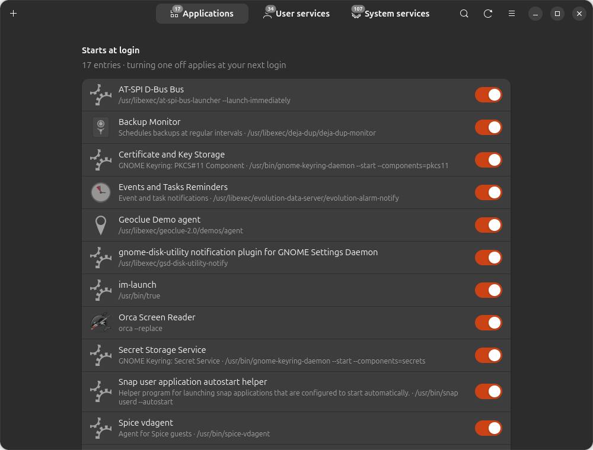
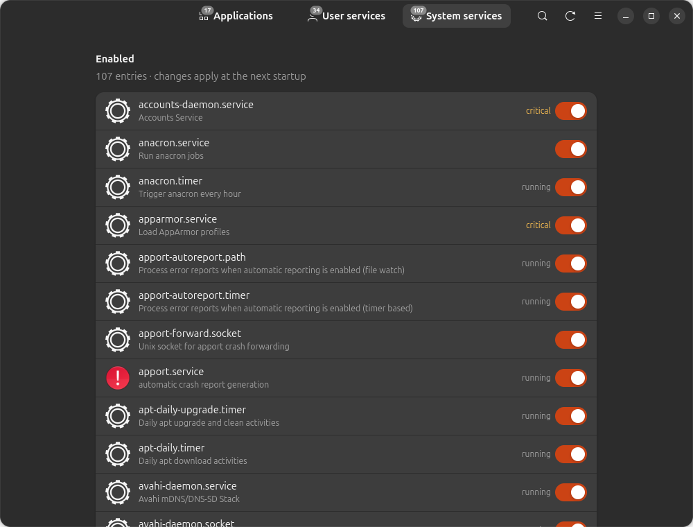

<div align="center">


# Liftoff

**Manage what starts with your session.**

See every application and service that launches by itself when you turn on
your computer — and switch off the ones you never asked for.

[](LICENSE)
[](https://github.com/M-SukruSezer/liftoff/releases)
[](#requirements)

[Türkçe](README.tr.md)



</div>

---

## Why

A fresh Linux install starts quietly. A year later, a dozen things launch
behind your back: a chat client, a sync daemon, a game launcher, an updater
that only ever updates itself. Your login takes longer, your fans spin up,
and nothing tells you who the culprits are.

The reason is that Linux has no single list. Startup items hide in **three
unrelated places**, each with its own rules and its own tooling:

| Where | What lives there | Usually edited with |
|---|---|---|
| `~/.config/autostart` and `/etc/xdg/autostart` | Desktop applications | a text editor |
| `systemctl --user` | Your own background services | the terminal |
| `systemctl` (system) | System-wide services | the terminal, as root |

Most desktop environments show you only the first one, and only part of it.
Liftoff shows all three in one window, and lets you turn any of them off
without learning three different tools.

## Features

- **One window, three sources.** Autostart entries, user services and system
  services, each in its own tab with a live count.
- **Tells you what it actually runs.** Every row shows the real command line
  and whether the entry is running *right now*, not just whether it is
  enabled.
- **Warns before you break something.** Entries your session depends on are
  marked, so you know which switch deserves a second thought.
- **Never destroys anything.** Turning off a system entry writes a personal
  override; turning it back on removes that override and restores the
  original exactly as it was.
- **Finds things fast.** Search by name, command or description, filter to
  enabled items only, and reveal the background components that are hidden
  by default.
- **Flatpak apps stay off.** Their autostart entry is written by the
  portal, so Liftoff does not stop at the file: it also withdraws the
  background permission. Otherwise the app has the entry written again the
  next time it runs.
- **Add your own.** Pick one of the installed applications or type any
  command, and it appears on your next login.
- **Edit any entry.** Name, description, command, icon and every other key
  in the `.desktop` file can be changed from the app. Changes to a system
  entry are saved as a personal copy; the original file stays untouched.
- **See what you are looking at.** Every row shows the application's or
  service's own icon, falling back to a generic one when there is none.
- **Speaks your language.** English and Turkish, switchable at any time.
  The first run follows your system language.
- **Looks like it belongs.** Built with GTK4 and libadwaita, so it follows
  your system theme, dark mode and accent colour.

## Screenshots

<table>
<tr>
<td width="50%"></td>
<td width="50%"></td>
</tr>
<tr>
<td align="center"><b>User services</b><br>Your own systemd units, no password needed</td>
<td align="center"><b>System services</b><br>System-wide units, with an administrator prompt</td>
</tr>
</table>

## Install

Liftoff is pure Python. One package works on **every architecture** —
64-bit, 32-bit and ARM alike — which is why the files below are marked
`all` and `noarch` instead of `x86_64`.

### Debian, Ubuntu, Linux Mint, Pop!\_OS

```bash
sudo apt install ./liftoff_1.1.0_all.deb
```

### Fedora, RHEL, openSUSE

```bash
sudo dnf install ./liftoff-1.1.0-1.noarch.rpm
```

### Arch Linux

```bash
git clone https://github.com/M-SukruSezer/liftoff.git
cd liftoff/packaging && makepkg -si
```

### Any distribution, system-wide

```bash
tar xf liftoff-1.1.0.tar.gz && cd liftoff-1.1.0 && sudo make install PREFIX=/usr
```

### Any distribution, just for you — no root

```bash
tar xf liftoff-1.1.0.tar.gz && cd liftoff-1.1.0 && ./install.sh
```

This installs into `~/.local`. If `~/.local/bin` is not on your `PATH`, the
script tells you how to add it. Remove it again with `./uninstall.sh`.

Downloads are on the [releases page](https://github.com/M-SukruSezer/liftoff/releases).

## Requirements

Python 3.9 or newer, GTK 4, libadwaita 1, and the Python bindings for both.
Every current desktop distribution ships these; most already have them
installed.

```bash
# Debian / Ubuntu
sudo apt install python3-gi gir1.2-gtk-4.0 gir1.2-adw-1

# Fedora
sudo dnf install python3-gobject gtk4 libadwaita

# Arch
sudo pacman -S python-gobject gtk4 libadwaita
```

`pkexec` (from PolicyKit) is needed only to change system-wide services. It
is already present on every desktop install; without it, the first two tabs
still work normally.

## How it works

Liftoff does not invent a storage format of its own. It writes exactly what
the underlying system expects, so anything you change stays correct even if
you later uninstall Liftoff.

**Applications.** Turning off an entry that lives in your home folder sets
`Hidden=true` in that file. Turning off a *system* entry does not touch the
system file at all — it copies the entry into `~/.config/autostart` and
disables the copy, which is the standard way to override a system default.
Turning it back on deletes the copy, and the system default applies again.

**Services.** Liftoff calls `systemctl enable` and `systemctl disable`,
exactly as you would in a terminal. System-wide units ask for your password
through `pkexec` first.

Nothing is deleted, and nothing is rewritten in place. Every change is a
file you can inspect, and a change you can undo from the same switch.

## When changes take effect

Switching an entry off does **not** stop what is already running. Autostart
applications and services are started at login, so the change applies at
your next login — Liftoff says so at the top of the window. Timers and
sockets you disable stop arming immediately, but a running service keeps
running until it stops on its own or you stop it.

## Language

The interface is available in **English** and **Turkish**, and you can
switch at any time from the menu — the window retranslates in place, with
no restart.

On first run Liftoff follows your system language: Turkish if your system is
Turkish, English otherwise. Your choice is remembered in
`~/.config/liftoff/settings.json` and takes precedence from then on.

## Building packages

```bash
make deb                    # Debian package  -> dist/
make install PREFIX=/usr    # straight into the filesystem
make check                  # validate the desktop entry and AppStream data
```

`make install` honours `DESTDIR` and `PREFIX`, so it drops into any
distribution's packaging workflow unchanged. The Arch and RPM definitions in
[`packaging/`](packaging) do exactly that.

A [Flatpak manifest](io.github.m_sukrusezer.Liftoff.yaml) is included for
building a sandboxed bundle locally:

```bash
flatpak-builder --user --install build io.github.m_sukrusezer.Liftoff.yaml
```

## Project layout

```
liftoff/
├─ ui.py             GTK4 / libadwaita interface
├─ xdg_autostart.py  .desktop autostart entries
├─ systemd.py        user and system units
├─ desktop.py        .desktop reader and writer
├─ i18n.py           English and Turkish strings
├─ settings.py       stored preferences
├─ host.py           host access when sandboxed
└─ models.py         shared data types
```

The `.desktop` writer is line based: it keeps comments, key order and
formatting intact, and only touches the keys it has to.

## Contributing

Issues and pull requests are welcome at
<https://github.com/M-SukruSezer/liftoff>. Adding a language means adding one
dictionary to `liftoff/i18n.py` — no build step, no tooling to install.

## License

[MIT](LICENSE)
