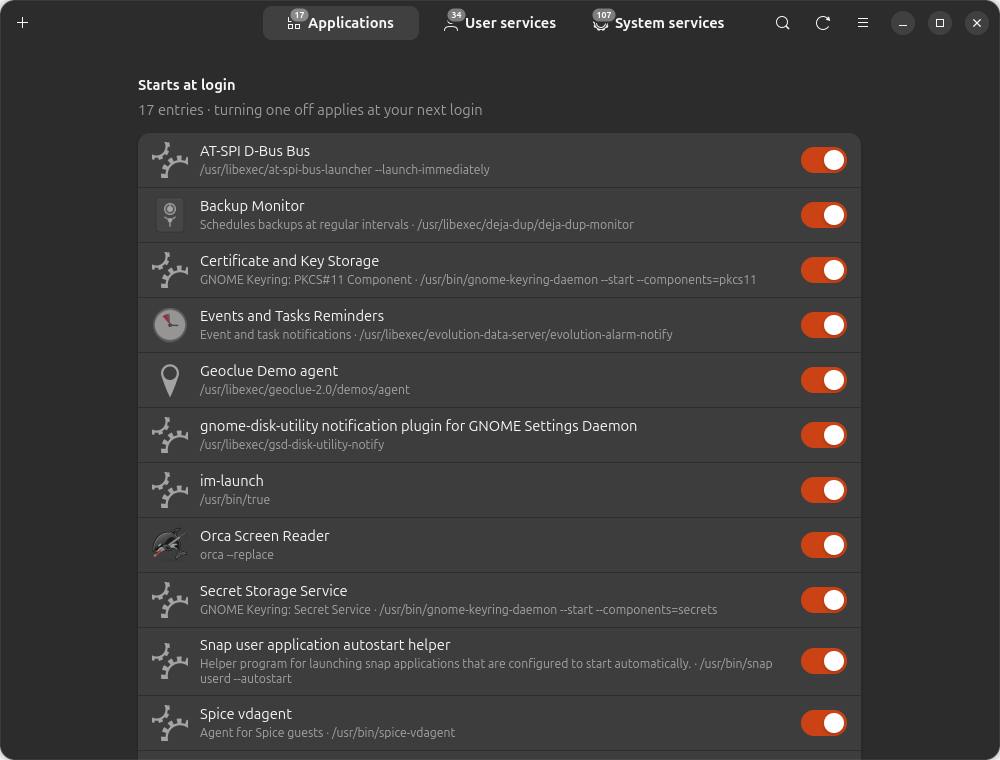
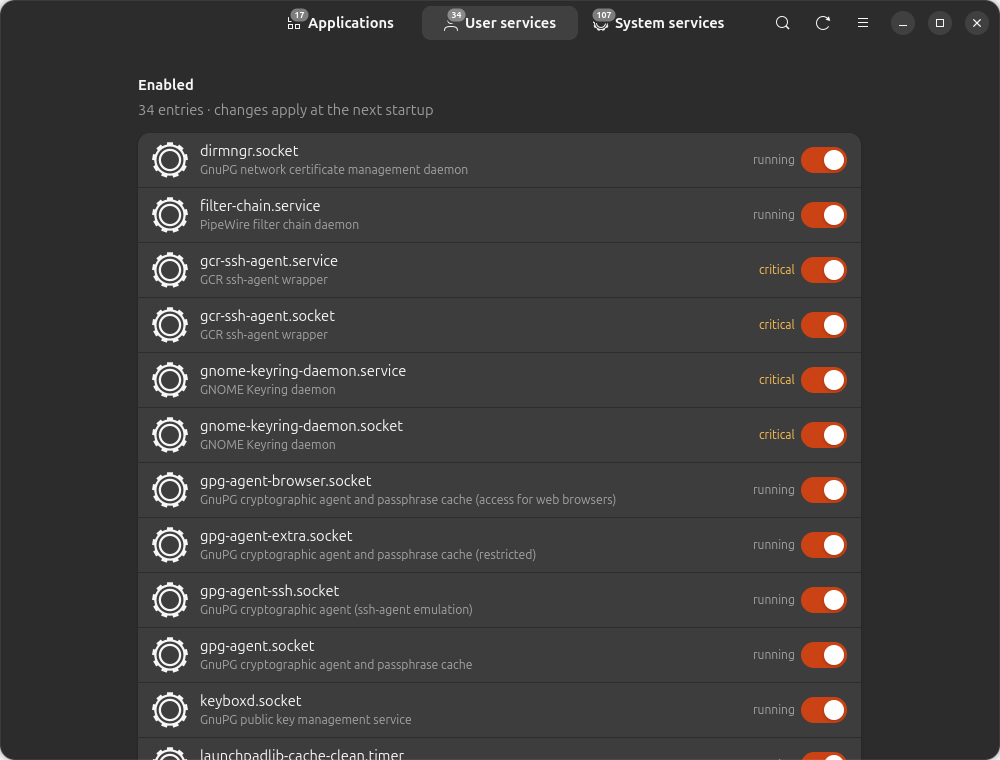
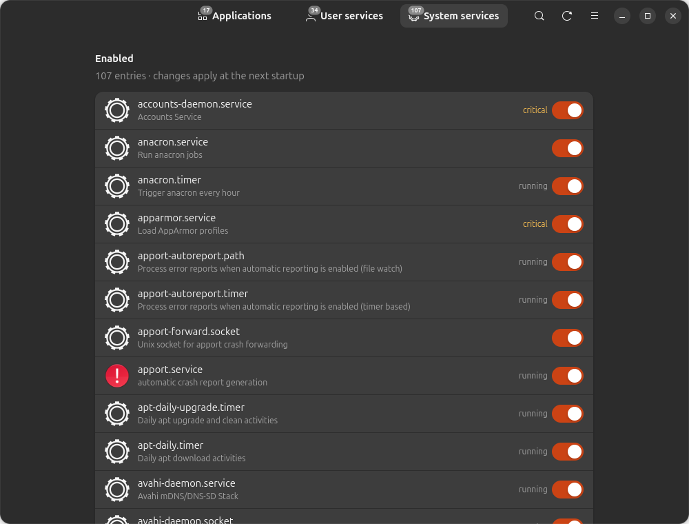

<div align="center">


# Liftoff

**Oturumunuzla birlikte neyin başladığını yönetin.**

Bilgisayarınızı açtığınızda kendiliğinden çalışan her uygulamayı ve servisi
görün, hiç istemediklerinizi kapatın.

[](LICENSE)
[](https://github.com/M-SukruSezer/liftoff/releases)
[](#gereksinimler)

[English](README.md)



</div>

---

## Neden

Yeni kurulmuş bir Linux sessizce açılır. Aradan bir yıl geçer, artık arka
planda bir düzine şey başlar: bir sohbet uygulaması, bir eşitleme servisi,
bir oyun başlatıcı, yalnızca kendini güncelleyen bir güncelleyici. Açılış
uzar, fanlar döner, ama bunu kimin yaptığını size kimse söylemez.

Sebebi şu: Linux'ta tek bir liste yoktur. Başlangıç girdileri **birbirinden
bağımsız üç yere** dağılmıştır; her birinin kendi kuralları ve kendi araçları
vardır:

| Yer | Orada ne bulunur | Genelde nasıl düzenlenir |
|---|---|---|
| `~/.config/autostart` ve `/etc/xdg/autostart` | Masaüstü uygulamaları | metin düzenleyiciyle |
| `systemctl --user` | Kendi arka plan servisleriniz | uçbirimden |
| `systemctl` (sistem) | Sistem geneli servisler | uçbirimden, root olarak |

Masaüstü ortamlarının çoğu size yalnızca birincisini, onu da eksik gösterir.
Liftoff üçünü tek pencerede toplar ve üç ayrı araç öğrenmeden herhangi
birini kapatmanızı sağlar.

## Özellikler

- **Tek pencere, üç kaynak.** Autostart girdileri, kullanıcı servisleri ve
  sistem servisleri; her biri kendi sekmesinde, canlı sayaçla.
- **Liste ilk sorunuzu yanıtlar.** Girdiler açılışta başlayanlar ve
  kapattıklarınız diye gruplanır; her satır küçük bir etiket taşır —
  çalışıyor, kritik ya da anahtar kullanılamıyorsa birimin durumu.
- **Gerçekte ne çalıştırdığını söyler.** Her satır girdiye verilmiş adı
  değil, arkasındaki asıl komut satırını gösterir.
- **Bir şeyi bozmadan önce uyarır.** Oturumunuzun bağlı olduğu girdiler
  işaretlidir; hangi anahtarın iki kez düşünmeyi hak ettiğini bilirsiniz.
- **Hiçbir şeyi yok etmez.** Bir sistem girdisini kapatmak kişisel bir
  geçersiz kılma yazar; tekrar açmak bu geçersiz kılmayı siler ve özgün
  hâli olduğu gibi geri getirir.
- **Aradığınızı hemen bulur.** Ada, komuta veya açıklamaya göre arayın,
  yalnızca açık olanları süzün, varsayılan olarak gizlenen arka plan
  bileşenlerini görünür yapın.
- **Kapattığınız Flatpak uygulaması kapalı kalır.** Bu uygulamaların
  autostart girdisini portal yazar; Liftoff dosyayı kapatmakla yetinmez,
  arka plan iznini de geri alır. Yoksa uygulama bir dahaki çalışmasında
  girdiyi yeniden yazdırır.
- **Kendi girdinizi ekleyin.** Kurulu uygulamalar arasından seçin ya da
  istediğiniz komutu yazın; bir sonraki girişinizde devreye girer.
- **Her girdiyi düzenleyin.** Ad, açıklama, komut, simge ve
  `.desktop` dosyasındaki diğer anahtarlar uygulamanın içinden
  değiştirilebilir. Sistem girdilerinde değişiklik kişisel bir kopyaya
  yazılır, özgün dosyaya dokunulmaz.
- **Neye baktığınızı görürsünüz.** Her satır uygulamanın ya da servisin
  kendi simgesini gösterir; bulunamayanlarda genel bir görsel kullanılır.
- **Dilinizi konuşur.** İngilizce ve Türkçe, istediğiniz an değiştirilebilir.
  İlk açılışta sistem dilinize uyar.
- **Sisteme ait görünür.** GTK4 ve libadwaita ile yazıldı; sistem temanızı,
  koyu kipi ve vurgu renginizi izler.

## Ekran görüntüleri

<table>
<tr>
<td width="50%"></td>
<td width="50%"></td>
</tr>
<tr>
<td align="center"><b>Kullanıcı servisleri</b><br>Kendi systemd birimleriniz, parola gerekmez</td>
<td align="center"><b>Sistem servisleri</b><br>Sistem geneli birimler, yönetici onayıyla</td>
</tr>
</table>

## Kurulum

Liftoff saf Python ile yazılmıştır. Tek bir paket **her mimaride** çalışır —
64-bit, 32-bit ve ARM dahil. Aşağıdaki dosyaların `x86_64` yerine `all` ve
`noarch` etiketi taşımasının sebebi budur.

### Debian, Ubuntu, Linux Mint, Pop!\_OS

```bash
sudo apt install ./liftoff_1.2.0_all.deb
```

### Fedora, RHEL, openSUSE

```bash
sudo dnf install ./liftoff-1.2.0-1.noarch.rpm
```

### Arch Linux

```bash
git clone https://github.com/M-SukruSezer/liftoff.git
cd liftoff/packaging && makepkg -si
```

### Her dağıtım, sistem geneli

```bash
tar xf liftoff-1.2.0.tar.gz && cd liftoff-1.2.0 && sudo make install PREFIX=/usr
```

### Her dağıtım, yalnızca kendiniz için — root gerekmez

```bash
tar xf liftoff-1.2.0.tar.gz && cd liftoff-1.2.0 && ./install.sh
```

Bu kurulum `~/.local` altına yapılır. `~/.local/bin` dizini `PATH`
içinde değilse betik size nasıl ekleyeceğinizi söyler. Kaldırmak için
`./uninstall.sh` çalıştırın.

Dosyalar [sürümler sayfasındadır](https://github.com/M-SukruSezer/liftoff/releases).

## Gereksinimler

Python 3.9 veya üzeri, GTK 4, libadwaita 1 ve ikisinin Python bağlayıcıları.
Güncel masaüstü dağıtımlarının tamamı bunları sunar; çoğunda zaten kuruludur.

```bash
# Debian / Ubuntu
sudo apt install python3-gi gir1.2-gtk-4.0 gir1.2-adw-1

# Fedora
sudo dnf install python3-gobject gtk4 libadwaita

# Arch
sudo pacman -S python-gobject gtk4 libadwaita
```

`pkexec` (PolicyKit) yalnızca sistem geneli servisleri değiştirmek için
gerekir. Her masaüstü kurulumunda hazır gelir; olmasa bile ilk iki sekme
normal çalışır.

## Nasıl çalışır

Liftoff kendine ait bir saklama biçimi uydurmaz. Alttaki sistemin beklediği
şeyi birebir yazar; böylece Liftoff'u sonradan kaldırsanız bile yaptığınız
değişiklikler geçerli kalır.

**Uygulamalar.** Ev dizininizdeki bir girdiyi kapatmak o dosyaya
`Hidden=true` yazar. Bir *sistem* girdisini kapatmak ise sistem dosyasına hiç
dokunmaz — girdiyi `~/.config/autostart` içine kopyalar ve kopyayı kapatır;
bu, bir sistem varsayılanını geçersiz kılmanın standart yoludur. Tekrar
açtığınızda kopya silinir ve sistem varsayılanı yeniden geçerli olur.

**Flatpak uygulamaları.** Bu uygulamaların autostart girdisi
`xdg-desktop-portal`'a aittir ve arkasındaki karar portalın izin deposunda
durur. Liftoff hem dosyayı yazar *hem de* arka plan iznini
`flatpak permission-set` ile geri alır — GNOME Ayarlar'ın değiştirdiği
kaydın aynısı. Bu ikinci adım olmadan uygulama bir dahaki çalışmasında
girdiyi yeniden yazdırır.

**Servisler.** Liftoff `systemctl enable` ve `systemctl disable` komutlarını
çağırır; uçbirimde sizin yapacağınızın aynısı. Sistem geneli birimler önce
`pkexec` aracılığıyla parolanızı sorar.

Hiçbir şey silinmez, hiçbir dosyanın üzerine körlemesine yazılmaz. Her
değişiklik inceleyebileceğiniz bir dosyadır ve aynı anahtardan geri
alabilirsiniz.

## Değişiklikler ne zaman geçerli olur

Bir girdiyi kapatmak hâlihazırda **çalışanı durdurmaz**. Autostart
uygulamaları ve servisler girişte başlatıldığı için değişiklik bir sonraki
oturum açışınızda geçerli olur; listenin üstündeki başlık bunu söyler.
Kapattığınız zamanlayıcı ve soketler hemen kurulmayı bırakır, ama çalışan
bir servis kendi duruncaya ya da siz durduruncaya kadar çalışmayı sürdürür.

## Dil

Arayüz **İngilizce** ve **Türkçe** sunulur, menüden istediğiniz an
değiştirebilirsiniz — pencere yerinde yeniden çevrilir, yeniden başlatma
gerekmez.

İlk açılışta Liftoff sistem dilinize uyar: sisteminiz Türkçeyse Türkçe,
değilse İngilizce. Seçiminiz `~/.config/liftoff/settings.json` içinde
saklanır ve o andan sonra önceliklidir.

## Paket üretme

```bash
make deb                    # Debian paketi -> dist/
make install PREFIX=/usr    # doğrudan dosya sistemine
make check                  # masaüstü girdisini ve AppStream verisini doğrula
```

`make install`, `DESTDIR` ve `PREFIX` değişkenlerine uyar; bu sayede her
dağıtımın paketleme akışına olduğu gibi girer.
[`packaging/`](packaging) altındaki Arch ve RPM tanımları tam olarak bunu
yapar.

Yerel olarak kumlanmış bir paket derlemek için
[Flatpak manifesti](io.github.m_sukrusezer.Liftoff.yaml) da bulunur:

```bash
flatpak-builder --user --install build io.github.m_sukrusezer.Liftoff.yaml
```

## Proje düzeni

```
liftoff/
├─ ui.py             GTK4 / libadwaita arayüzü
├─ xdg_autostart.py  .desktop autostart girdileri
├─ systemd.py        kullanıcı ve sistem birimleri
├─ portal.py         Flatpak arka plan izinleri
├─ desktop.py        .desktop okuyucu ve yazıcı
├─ icons.py          her girdinin kendi simgesini bulur
├─ apps.py           kurulu uygulamalar, seçici için
├─ i18n.py           İngilizce ve Türkçe metinler
├─ settings.py       saklanan tercihler
├─ host.py           kumlandığında ana makineye erişim
└─ models.py         ortak veri türleri
```

`.desktop` yazıcısı satır temellidir: yorumları, anahtar sırasını ve biçimi
olduğu gibi korur, yalnızca değiştirmesi gereken anahtarlara dokunur.

## Katkı

Hata bildirimleri ve değişiklik önerileri için
<https://github.com/M-SukruSezer/liftoff>. Yeni bir dil eklemek,
`liftoff/i18n.py` dosyasına tek bir sözlük eklemek demektir — derleme adımı
yok, kurulacak araç yok.

## Lisans

[MIT](LICENSE)
